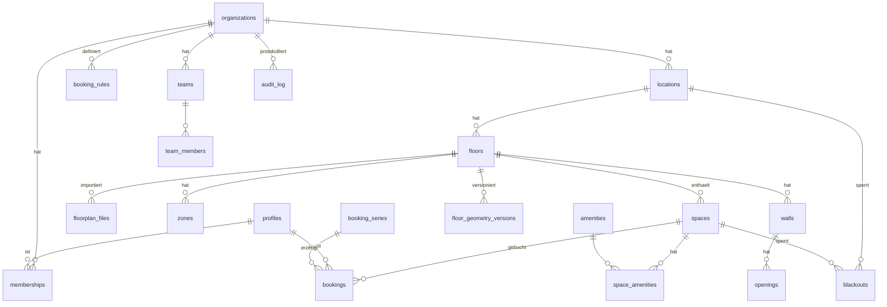

# Architektur – Büro- und Raumplanungssystem (SaaS)

> **Stand: Phase 0 freigegeben (25.11.2026).** Entscheidungen und Begründungen: [PROGRESS.md](./PROGRESS.md#6-entscheidungen).

## 1. Ist-Stand des Repos

| Bereich | Stand |
|---|---|
| Struktur | Monorepo-Wurzel mit `saas/` (Next.js-App), `README.md`, `LICENSE` |
| Framework | Next.js **16.4.6** (App Router, `cacheComponents: true`, `partialPrefetching`, Turbopack), React **19.3** |
| Styling | Tailwind CSS **4.3** (`@tailwindcss/turbopack`), Schrift Geist |
| Paketmanager | **Bun 1.3.14** (`bun.lock`) |
| Qualität | ESLint 9 (`eslint-config-next`), TypeScript strict; **keine Tests**, keine CI |
| DB/Auth | Supabase-Entwicklungsprojekt `Raumplanungs_SaaS` (Ref `nojkevaqbjllfhhehxok`, Frankfurt, Postgres 17) + lokale Instanz (Docker). Ein separates Projekt mit Produktivdaten existiert und wird von Agenten **nie** verwendet. Kein Prisma/Clerk im Repo (nichts zu entfernen). |
| Besonderheit Next 16 | `middleware.ts` heißt jetzt **`proxy.ts`** (Node-Runtime als Standard). Vor jedem Code die Doku in `saas/node_modules/next/dist/docs/` lesen (siehe `saas/AGENTS.md`). |
| Baseline | `bun run lint` ✔, `tsc --noEmit` ✔ (25.11.2026) |

## 2. Designsprache (aus den Vorlagen)

Hauptreferenz ist der **App-Dashboard-Screenshot (D)**. Die Website-Abschnitte (B1–B8, PDF) liefern ergänzende Komponentenstile.

| Merkmal | App-Dashboard (D) | Website (B/PDF) |
|---|---|---|
| Primärfarbe | Violett/Indigo-Verlauf (~`#5B3DF5` → `#7C5CFF`) für aktive Navigation und Primär-Buttons | Blau ~`#0B5C9E` (Header, Buttons, Icon-Kacheln) |
| Navigation | Dunkle Seitenleiste (Navy ~`#11163A`), weiße Schrift, aktive Zeile als Pill mit Verlauf, Zähler-Badge (rot) | Horizontale Top-Navigation |
| Hintergrund/Flächen | Hellgrau ~`#F5F7FB`, weiße Karten, Radius ~12 px, weiche Schatten | Weiß/`#F5F7FA`, Karten mit 1 px Rahmen `#E3E8EF`, Radius 12–16 px |
| Überschriften | Dunkles Navy ~`#1B2541`, fett | Dunkles Navy, sehr fett, Eyebrow-Labels in Versalien mit Linien („— BENEFITS —“) |
| Kennzahl-Kacheln | Farbige Icon-Quadrate (Violett, Grün, Orange, Blau, Pink), große Zahl, Trend grün/rot („↑ 12,4 % vs. Vorwoche“) | Kennzahl-Karten mit Fortschrittsbalken (Orange/Grün/Gelb) |
| Status-Farben Grundriss | Verfügbar **grün**, Gebucht **orange**, Nicht verfügbar **grau**, Eigene Buchung **blau** | Verfügbar blau, Gebucht braun, Meins grün, Reinigung gelb |
| Diagramme | Linie (Auslastung), Ring (Buchungsübersicht), Balken (Monatsauslastung) | – |
| Icons | Outline-Linien-Icons (Lucide-ähnlich) | Outline-Icons in Kacheln |
| Schrift | Neo-Grotesk (Inter/Helvetica-ähnlich) | Helvetica/Arial |
| Interaktion | Akkordeon (FAQ, „How it works“) mit runden Chevron-Buttons | – |

**Festgelegt:** App-Dashboard-Palette und Statusfarben aus D, zusätzlich je Status ein **Icon/Muster und Text** (WCAG: nicht nur Farbe). Schrift: Geist (bereits im Repo, Inter-ähnlich, lizenzfrei). Tokens als CSS-Variablen in `@theme` (Tailwind 4). Eigenes Branding (Arbeitstitel „Raumplanung“), keine Übernahme von Logo/Texten der Vorlage.

## 3. Stack-Entscheidungen

Freigegeben am 25.11.2026. Abweichend von der ursprünglichen Empfehlung gilt beim **Datenzugriff Prisma** (siehe 3.1) und beim **Error-Tracking Sentry ab Phase 1**.

| Thema | Vorschlag | Begründung | Alternativen |
|---|---|---|---|
| Datenzugriff | **Prisma** auf Supabase-Postgres (Entscheidung Nutzer), siehe 3.1; supabase-js/`@supabase/ssr` weiterhin für Auth, Storage und Realtime | – | Supabase-nativ (ursprüngliche Empfehlung) |
| UI-Komponenten | **shadcn/ui** (Radix-Primitives, Code wird ins Repo kopiert, MIT) + **lucide-react** | Barrierefreie Primitives (Fokus, Tastatur), voll an Tokens anpassbar, Tailwind-4-kompatibel | Mantine, eigene Komponenten |
| Formulare/Validierung | **zod** (Server + Client) + `react-hook-form` | Ein Schema für Server Actions und Formulare | valibot, conform |
| Diagramme | **Recharts** (MIT) | Linie/Ring/Balken wie in D, SVG, gut zugänglich | ECharts, Nivo |
| Datum/Zeit | **date-fns 4 + @date-fns/tz** | Zeitzone Europe/Berlin, DST-sicher, `de`-Locale | Luxon, Temporal-Polyfill |
| Kalender | **FullCalendar Standard (MIT)**: Tag, Woche, Monat, Liste, `de`-Locale, Wochenstart Montag, benannte Zeitzonen | Ausgereift, Touch, Tastatur, Agenda-Ansicht; Ressourcenansicht ist kostenpflichtig (Premium ab ~480 $/Jahr), wird in den Vorlagen aber **nicht** verlangt | react-big-calendar (MIT, Ressourcen gratis, weniger gepflegt); Schedule-X (Drag & Drop/Ressourcen Premium) |
| 2D-Grundriss | **SVG** für Ansicht **und** Editor, Zoom/Pan per `@use-gesture/react` | Scharf, jeder Platz ist ein fokussierbares DOM-Element (Tastatur, Screenreader, Tests), CSS-Theming; Bürogrundrisse haben meist < 2 000 Objekte | Konva/Canvas (schneller bei sehr vielen Objekten, aber schlechtere Barrierefreiheit) |
| Zustand | URL-Parameter (Standort, Stockwerk, Datum) + **Zustand** für Editor/Undo und 2D/3D-Auswahl | Teilbarer Zustand, einfache Undo-Historie | Redux Toolkit, Jotai |
| Live-Aktualisierung | **Supabase Realtime Broadcast aus der Datenbank** (Trigger → privater Kanal je Organisation/Stockwerk, Payload ohne Personenbezug) + Revalidierung als Fallback | `postgres_changes` beachtet RLS: Mitarbeiter dürfen fremde Buchungszeilen nicht lesen → keine Events bzw. Datenleck bei zu offener Policy. Broadcast-Payload enthält nur `space_id`, Zeitraum, Status | Polling (einfach, aber träge und teurer) |
| Uploads | **Supabase Storage**, privater Bucket `floorplans`, Pfad `{org_id}/{floor_id}/{file_id}`, signierte URLs | Mandantentrennung über Storage-RLS | eigener S3 |
| Import-Parsing | PDF: `pdfjs-dist` (Apache-2.0); DXF: `dxf-parser` (MIT); SVG: Sanitizing (Allowlist, z. B. DOMPurify) + `svgson`; Raster: OpenCV.js (Apache-2.0) im Web Worker; Typprüfung per Magic Bytes (`file-type`) | Vektordaten direkt auswertbar; Raster nur als Konturvorschlag | Server-Python-Dienst (mehr Infrastruktur) |
| 3D | **three + @react-three/fiber + @react-three/drei** (MIT), `earcut` (ISC), **Clipper2** (Paket `clipper2-js`, Pflege/Lizenz vor Einbau prüfen) | Passt zu React, Lazy Loading möglich; Babylon.js schwerer und weniger React-nah | Babylon.js |
| Scheduler | **pg_cron + pg_net** (Supabase) ruft alle 5 min den internen Readiness-Check der App auf (Geheimnis in Supabase Vault); Aufräumjob täglich | Kein Zusatzdienst; läuft auch ohne Hosting-Cron | Vercel Cron, GitHub Actions Schedule |
| Error-Tracking | **Sentry (EU-Datenregion) ab Phase 1**, PII-Scrubbing (`sendDefaultPii: false`, `beforeSend` filtert Nutzerdaten), Source-Maps nur per CI-Token hochladen; zusätzlich aggregierte `error_events` für die Systemstatus-Seite | Entscheidung Nutzer | eigene Lösung zuerst |
| Tests | **Vitest** + Testing Library (Unit/Komponenten), **Playwright** (E2E, Responsive, WebGL-Smoke), **@axe-core/playwright** (A11y), **pgTAP** via `supabase test db` | Standard im Next-Ökosystem | Jest |
| CI/Sicherheit | GitHub Actions: Lint, Typecheck, Build, Tests, pgTAP (lokale Supabase im Runner); **CodeQL**, **gitleaks** (Secret-Scan), `bun audit`, **Dependabot**; wöchentlicher Security-Lauf | Wächter-Schicht 2 | Snyk, Trivy |
| Hosting | **Vercel, Region Frankfurt (`fra1`)** | Next-nativ, EU-Region | Docker auf eigenem Server |

### 3.1 Prisma mit Supabase

- **Quelle der Wahrheit:** SQL-Migrationen per Supabase CLI (`saas/supabase/migrations`), weil Exclusion-Constraints, RLS-Policies, Trigger, pg_cron und Storage-Policies in Prisma nicht modellierbar sind. Das Prisma-Schema wird per `prisma db pull` erzeugt, **kein** `prisma migrate`.
- **RLS bleibt aktiv:** Prisma-Client-Extension führt jede Abfrage in einer Transaktion aus: `set local role authenticated` + `set_config('request.jwt.claims', <verifizierte Claims>, true)`. Damit gelten dieselben Policies wie bei supabase-js. Zusätzlich prüft der Server-Code Rolle und Mandant (doppelte Absicherung).
- **System-Client:** separater Prisma-Client ohne Rollenwechsel nur für vertrauenswürdige Serveraufgaben (Healthchecks, Einladungen, Jobs), nie aus Nutzereingaben gesteuert.
- **Verbindungen:** `DATABASE_URL` = Supavisor im Transaction-Modus (Port 6543, `pgbouncer=true`) für Vercel; `DIRECT_URL` = Session-/Direktverbindung für Introspection. Eigene DB-Rolle für Prisma (ohne Superuser), die in `authenticated` wechseln darf.
- **Messung in Phase 1:** Overhead der RLS-Extension je Abfrage.

## 4. Zielstruktur (Vorschlag)

```
saas/
  app/
    (auth)/anmelden, registrieren, passwort-vergessen, einladung/[token]
    (app)/dashboard, buchen, meine-buchungen, kalender, grundriss/[floorId]
    (admin)/admin/{statistiken,benutzer,regeln,kalender,sperrzeiten,standorte,editor/[floorId],systemstatus}
    api/health/route.ts, api/health/ready/route.ts, api/internal/healthcheck/route.ts
  components/ui/          # shadcn-Basis (Design-System-Agent)
  components/floorplan/   # 2D (2D-Agent)
  components/three/       # 3D (3D-Agent)
  components/calendar/    # Kalender (Buchung-&-Kalender-Agent)
  lib/supabase/           # Browser-/Server-Client (Auth, Storage, Realtime), proxy-Helfer (DB/Auth-Agent)
  lib/db/                 # Prisma-Client mit RLS-Extension + System-Client (DB/Auth-Agent)
  prisma/schema.prisma    # per `prisma db pull` aus der DB erzeugt
  lib/booking/            # Regeln, Zeitzonen, Überschneidung (reine Funktionen)
  lib/floorplan/import/   # Parser, Sanitizer, Erkennung
  lib/three/buildScene.ts # reiner Szenen-Generator
  lib/monitoring/         # Health-Checks, Logger (Korrelations-ID)
  proxy.ts                # Session-Refresh (Next 16)
  supabase/{config.toml,migrations/,seed.sql,tests/}
  tests/{unit,e2e}/
docs/  .github/{workflows,agents,prompts,skills}/
```

## 5. Datenmodell (Entwurf)

Alle Tabellen im Schema `public` mit `org_id`, RLS aktiv, Standard „kein Zugriff“. Hilfsfunktionen im **nicht exponierten** Schema `private`.



| Tabelle | Wichtige Spalten |
|---|---|
| `profiles` | `id` = `auth.users.id`, `display_name`, `locale`, `deactivated_at` |
| `organizations` | `id`, `name`, `slug`, `default_timezone` (Europe/Berlin) |
| `memberships` | `org_id`, `user_id`, `role` (`admin` · `manager` · `employee`), unique (org, user) – **einzige Quelle für Mandanten-Rollen**. Plattform-Super-Admin separat in `platform_admins` (nur per SQL/Service gesetzt) |
| `locations` | `org_id`, `name`, `address`, `timezone` |
| `floors` | `location_id`, `name`, `sort_order`, `scale_m_per_unit`, `floor_height_m` (Std. 3,0), `elevation_m`, `geometry_version` |
| `floorplan_files` | `floor_id`, `storage_path`, `mime_type`, `size_bytes`, `sha256`, `status` (hochgeladen/verarbeitet/fehlgeschlagen), `version` |
| `zones` | `floor_id`, `name`, `polygon jsonb`, `restricted bool` |
| `spaces` | `floor_id`, `zone_id`, `kind` (`desk` · `meeting_room` · `phone_booth` …), `name`, `polygon jsonb` bzw. `position`, `capacity`, `status` (`active` · `cleaning` · `out_of_service`) |
| `walls` | `floor_id`, `x1,y1,x2,y2`, `thickness_m`, `height_m` (null = Geschosshöhe) |
| `openings` | `wall_id`, `kind` (`door`/`window`), `offset_m`, `width_m`, `height_m`, `sill_height_m` |
| `bookings` | `org_id`, `space_id`, `user_id`, `booked_by`, `starts_at`/`ends_at` (timestamptz, UTC), `period tstzrange` (generiert), `status` (`confirmed`/`cancelled`/`checked_in`/`no_show`), `title`, `series_id`, `checked_in_at` |
| `blackouts` | `org_id`, `location_id` oder `space_id`, `period tstzrange`, `reason` |
| `booking_rules` | `org_id`, optional `location_id`/`space_kind`, `max_duration`, `min_lead_time`, `max_advance_days`, `max_active_per_user`, `bookable_hours` |
| `teams`, `team_members`, `team_areas` | Teams, Mitglieder, Team-Sitzbereiche (Zonen) |
| `checkins` bzw. `bookings.checked_in_at` | Check-in per QR-Code (signierter, rotierbarer Platz-Code) oder Web |
| `audit_log` | `org_id`, `actor_id`, `action`, `entity`, `entity_id`, `at`, `diff jsonb` (ohne unnötige PII) |
| Monitoring | `health_check_runs` (`at`, `component`, `status`, `latency_ms`, `message`), `incidents` (`started_at`, `ended_at`, `severity`, `component`), `alert_settings`, `error_events` (aggregiert, ohne PII) |
| `calendar_feed_tokens` | `user_id`, `token_hash`, `created_at`, `revoked_at` (ICS-Feed, freigegeben) |
| `calendar_connections` | später: Google/Microsoft-OAuth (Tokens verschlüsselt, nur serverseitig) |
| optional | `scene_exports` (GLB-Pfad + `geometry_version`) |

**Kein eigener Kalender-Speicher:** Der Kalender liest `bookings` + `blackouts`.

**Doppelbuchungen:** `btree_gist`-Exclusion-Constraint
`EXCLUDE USING gist (space_id WITH =, period WITH &&) WHERE (status IN ('confirmed','checked_in'))`.
Sperrzeiten werden in der Buchungsfunktion (`create_booking`, Transaktion) und per Trigger geprüft; Regeln serverseitig in derselben Funktion.

**Indizes:** `bookings (org_id, space_id)`, GiST auf `period`, `bookings (user_id, starts_at)`, `blackouts` GiST auf `period`, FK-Indizes, Policy-Spalten (`org_id`, `user_id`).

## 6. RLS- und Auth-Konzept

- Rolle und Organisation kommen **nur** aus `memberships` (nie aus `user_metadata`). Hilfsfunktionen `private.is_member(org_id)` / `private.has_role(org_id, role)` (`SECURITY DEFINER`, fester `search_path`, im nicht exponierten Schema), in Policies als `(select …)` aufgerufen.
- Policies je Tabelle und Operation mit `TO authenticated` + Mandanten-Prädikat; UPDATE immer mit `USING` **und** `WITH CHECK`.
- `bookings`: Mitarbeiter lesen/ändern nur **eigene** Zeilen; Manager zusätzlich die ihrer Teams (Buchen für andere); Admins alle ihrer Organisation.
- **Belegung ohne Personenbezug:** RPC `get_occupancy(floor_id, from, to)` → `space_id`, Zeitraum, Status, `is_own`; **keine** `user_id`/Namen für Nicht-Admins. Umsetzung als `SECURITY INVOKER`-Funktion in `public`, die eine geprüfte `private`-Funktion aufruft (Mitgliedschaft im Funktionskörper geprüft).
- Views nur mit `security_invoker = true`.
- Storage-Policies auf `storage.objects`: erster Pfadteil = `org_id`, Lesen für Mitglieder, Schreiben für Admins.
- Auth: Supabase Auth mit **E-Mail + Passwort**; Firmen registrieren sich selbst (erster Nutzer wird Admin), Mitarbeiter nur per Einladung. E-Mail-Bestätigung, Redirect-Allowlist, Rate Limits, eigener SMTP für Produktion. Session-Refresh in `proxy.ts`, Prüfung serverseitig mit `getClaims()`/`getUser()`.
- Geheimer Schlüssel (`SUPABASE_SECRET_KEY`) nur in Server-Code (Einladungen, interne Jobs).

## 7. Kalender-Konzept

- **Datenfluss:** Buchung/Änderung/Storno → `bookings` → DB-Trigger sendet Broadcast (ohne PII) auf `org:{id}:floor:{id}` → Kalender und Grundriss laden den betroffenen Zeitraum neu. Eigene Details über RLS-geschützte Abfragen.
- **Ansichten:** Tag, Woche, Monat, Agenda (Mobil-Standard: Tag/Agenda); Mein Kalender, Raumkalender, Gesamtkalender (Admin) mit Filtern Standort/Stockwerk/Raum/Typ/Team/Person.
- **Zeit:** Speicherung UTC, Anzeige in Standort-Zeitzone; Wochenstart Montag; Tests für 23-/25-Stunden-Tage und Buchungen über Mitternacht.
- **Laden:** nur sichtbarer Zeitraum (`period && tstzrange(from, to)`, GiST-Index).
- **Erweiterungen (freigegeben):** persönlicher ICS-Abo-Feed (nur eigene Buchungen, Token gehasht, widerrufbar), später Google-/Microsoft-Kalender per OAuth. **Nicht** geplant: Serienbuchungen, E-Mail-Bestätigungen.

## 8. Import- und Erkennungs-Pipeline

Upload (Größenlimit, Magic-Byte-Prüfung) → Storage (privat) → Verarbeitung isoliert mit Timeout (Worker) → Normalisierung zu SVG/Vektordaten → Erkennung (Vektor: geschlossene Konturen → Raum-Kandidaten, Linien-Layer → Wände, DXF-Blöcke/Bögen → Türen; Raster: Konturen via OpenCV.js, nur Vorschlag) → Vorschläge im Editor → Bestätigung → `walls`/`openings`/`spaces` + neue `geometry_version`.
Detaillierte Optionen (Aufwand/Genauigkeit/Kosten) legt der Import-Agent zu Beginn von Phase 2 vor.

## 9. 3D-Konzept

- **Quelle:** bestätigte Geometrie aus der DB (nicht die Originaldatei).
- **Generator:** `buildScene(geometry, options)` – rein, deterministisch, ohne WebGL testbar; validiert Eingaben (max. Wände/Punkte, endliche Zahlen, Null-Längen verwerfen).
- **Erzeugung:** Wände als Segmente, an Öffnungen geteilt (Brüstung/Sturz als eigene Boxen); Böden per `Shape`/`earcut`; Wandverschmelzung per Clipper2; Plätze als `InstancedMesh`.
- **Empfehlung:** **Laufzeit-Erzeugung** (Bürogrößen sind klein, immer aktuell); GLB-Cache nur bei gemessenem Bedarf.
- **Performance-Budget (Vorschlag):** ≥ 50 fps Desktop / ≥ 30 fps Mittelklasse-Handy bei 1 Stockwerk mit 500 Plätzen; 3D-Bundle lazy, ≤ 350 kB gzip; Szene < 1 s bei 2 000 Wänden; `dpr` mobil ≤ 1,5; `dispose` beim Verlassen.
- **Fallback:** ohne WebGL deutscher Hinweis, 2D bleibt voll nutzbar.
- **Zuständigkeit:** **Variante A – eigener 3D-Agent** (umfangreich, gut abgrenzbar).

## 10. Monitoring- und Healthcheck-Konzept

| Endpunkt | Inhalt | Zugriff |
|---|---|---|
| `GET /api/health` | `{status:"ok"}`, keine Abhängigkeiten | öffentlich, Rate Limit |
| `GET /api/health/ready` | nur Gesamtstatus `ok/eingeschränkt/ausgefallen` | öffentlich, Rate Limit |
| `POST /api/internal/healthcheck` | Einzelprüfungen (DB, Auth, Storage, Pipeline, Env-Variablen vorhanden – ohne Werte), Timeout je Komponente, schreibt `health_check_runs` | nur mit internem Geheimnis (pg_cron/pg_net) bzw. Admin-Session („Jetzt prüfen“, Rate Limit) |

- Intervall 5 min (pg_cron), Aufbewahrung: Rohdaten 30 Tage, danach Tagesaggregate.
- Admin-Seite „Systemstatus“: Ampel + Text, Komponenten, Antwortzeiten, Verfügbarkeit 24 h/7 T/30 T, Vorfälle, Fehlerübersicht, Pipeline-Status, Schwellenwerte, Warnungen **nur im Dashboard**.
- Strukturierte JSON-Logs mit Korrelations-ID (`x-request-id` aus `proxy.ts`), ohne Secrets/PII; unbehandelte Fehler an Sentry (EU).
- **Sichtbarkeit (festgelegt):** Plattform-Super-Admin sieht alles; Mandanten-Admins sehen den Plattform-Komponentenstatus ohne Details und nur eigene Pipeline-Fehler.

## 11. Sicherheitskonzept (Kurzfassung)

Serverseitige Validierung (zod), Autorisierung bei jedem Zugriff + RLS, Sicherheits-Header (CSP mit Nonce, HSTS, `X-Content-Type-Options`, `Referrer-Policy`, `frame-ancestors 'none'`), sichere Cookies (`HttpOnly`, `Secure`, `SameSite=Lax`), CSRF-Schutz der Server Actions (Origin-Prüfung), Upload-Härtung, Rate Limits (Upload, Buchung, Feed, Health), deutsche Fehlermeldungen ohne interne Details, Supabase Advisors regelmäßig, keine Secrets im Repo/Client-Bundle (CI-Prüfung).

## 12. Umgebungsvariablen (nur Namen)

| Variable | Zweck | Sichtbarkeit |
|---|---|---|
| `NEXT_PUBLIC_SUPABASE_URL` | API-URL des Projekts | Client |
| `NEXT_PUBLIC_SUPABASE_PUBLISHABLE_KEY` | öffentlicher Schlüssel (RLS schützt Daten) | Client |
| `SUPABASE_SECRET_KEY` | geheimer Schlüssel für vertrauenswürdige Serveraufgaben | **nur Server** |
| `DATABASE_URL` | Prisma, Supavisor Transaction-Modus (Port 6543) | **nur Server** |
| `DIRECT_URL` | Prisma Introspection, Session-/Direktverbindung | **nur Server** |
| `HEALTHCHECK_INTERNAL_SECRET` | Absicherung des internen Healthcheck-Aufrufs | **nur Server** (+ Supabase Vault) |
| `NEXT_PUBLIC_SENTRY_DSN` | Sentry-DSN (nicht geheim, nur Ingest) | Client |
| `SENTRY_AUTH_TOKEN` | Upload der Source-Maps in CI | **nur CI** |

## 13. Subagenten-Plan (Vorschlag)

| # | Agent | Dateibesitz | Phasen |
|---|---|---|---|
| 1 | **Supabase/DB/Auth** | `saas/supabase/**`, `saas/prisma/**`, `saas/lib/db/**`, `saas/lib/supabase/**`, `saas/proxy.ts` | 1–6 (einziger Schema-Besitzer) |
| 2 | **Design-System & Layout** | `saas/components/ui/**`, `saas/app/globals.css`, Layout/Navigation | 1, 6 |
| 3 | **Import & Erkennung** | `saas/lib/floorplan/import/**`, Upload-Routen | 2 |
| 4 | **2D-Grundriss & Editor** | `saas/components/floorplan/**`, Editor-Seiten | 2–3 |
| 5 | **Buchung & Kalender** (Kalender-Zuständigkeit) | `saas/lib/booking/**`, `saas/components/calendar/**`, Buchungs-/Kalender-Seiten | 3–4 |
| 6 | **Admin-Dashboard & Statistik** | `saas/app/(admin)/**` außer Systemstatus/Editor | 4 |
| 7 | **Monitoring** | `saas/lib/monitoring/**`, `saas/app/api/health/**`, Systemstatus-Seite | 1, 4 |
| 8 | **3D** (Variante A) | `saas/lib/three/**`, `saas/components/three/**` | 5 (Generator ab Ende Phase 2) |
| 9 | **QA/Test** | `saas/tests/e2e/**`, Playwright-Konfiguration | 1–6 |
| 10 | **Wächter** (Pflicht) | nur Berichte; triviale Fixes dokumentiert | alle |
| – | **Main Agent** | `package.json`/Lockfile, `next.config.ts`, CI, `docs/**`, Integration | alle |

Der Wächter wird als Vorlage unter `.github/agents/waechter.agent.md` und `.github/prompts/waechter-audit.prompt.md` angelegt (Phase 1).

## 14. Setup und Tests

Wird in Phase 1 ergänzt (lokale Supabase mit Docker, `bun install`, `.env.local`, `bunx supabase start`, `bun run test`, `bunx supabase test db`, `bunx playwright test`).
